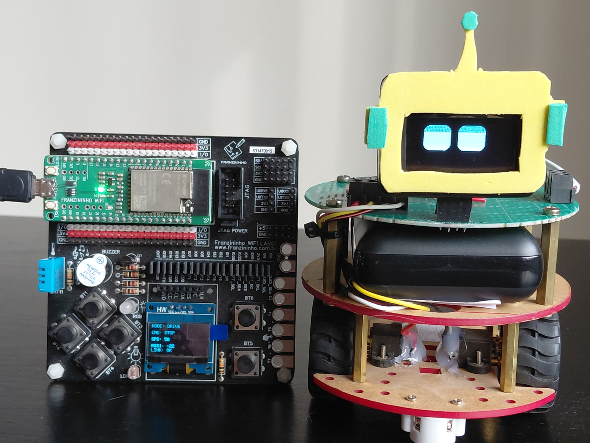
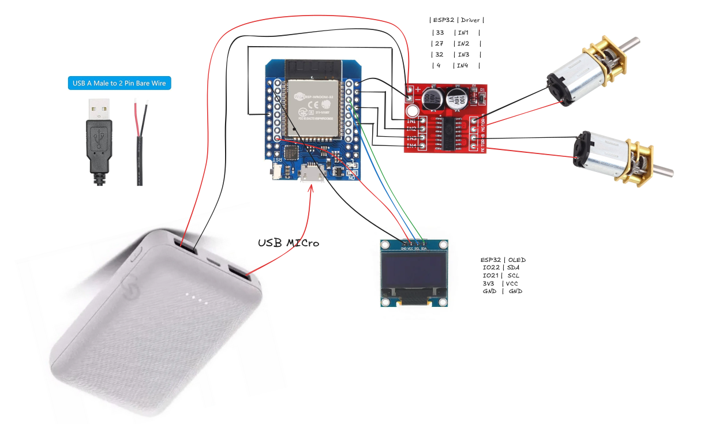
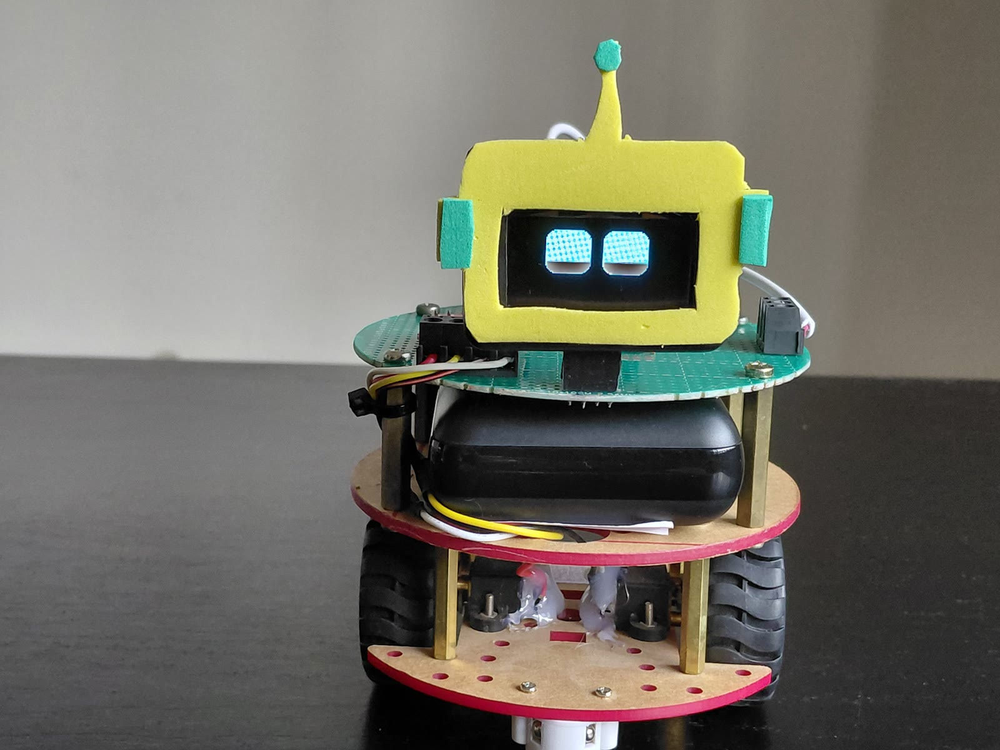
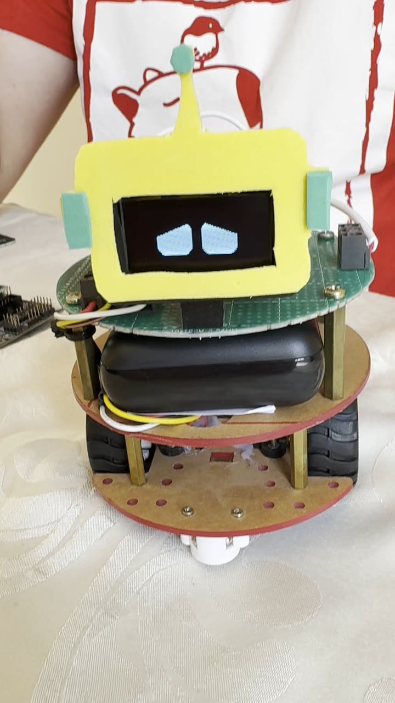
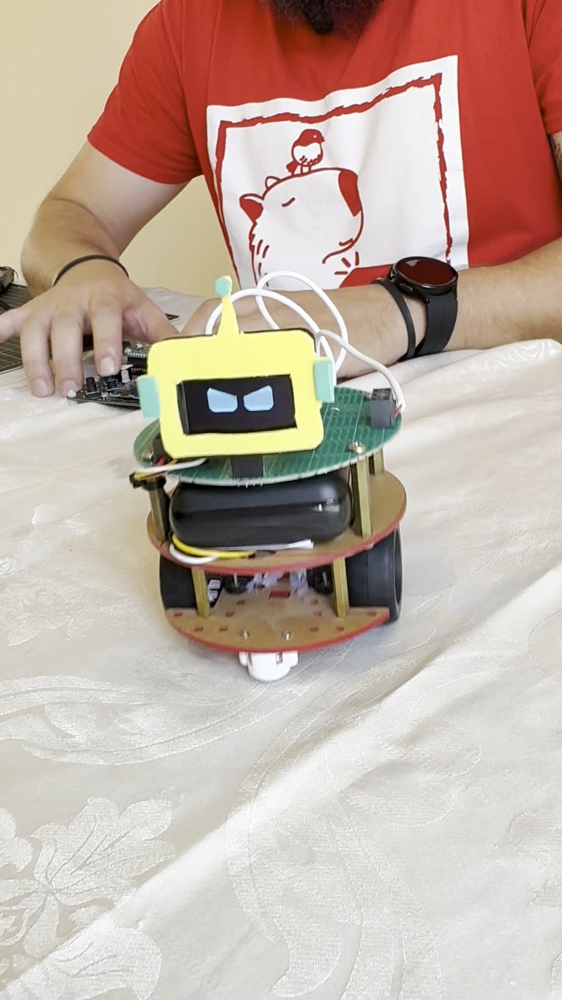
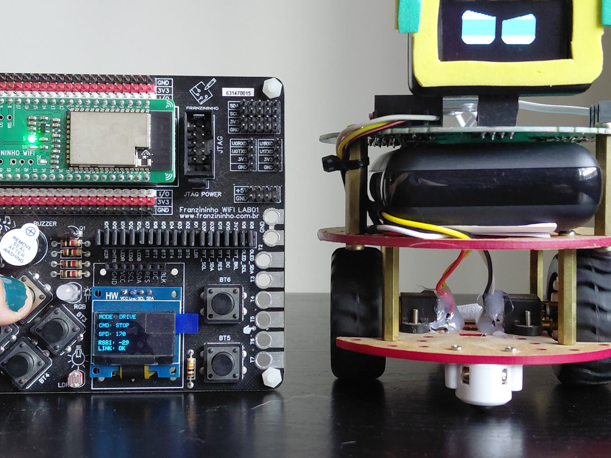

# ESP-NOW Robot Control System

A wireless robot control system using the ESP-NOW protocol for ESP32-based devices.
This repository includes two firmware projects:

- **control_espnow/**: handheld controller with OLED display and buttons
- **robot_espnow/**: robot receiver that drives the motors and shows animated eyes

The system is designed for low-latency communication without relying on a traditional Wi-Fi network.



## Key Features

- 6-button interface for direction and speed control
- ESP-NOW communication with automatic peer discovery
- Commands sent immediately on change and repeated every 100 ms as keep-alive
- Robot fail-safe: motors stop if no command arrives for 500 ms
- OLED on the controller showing command, speed, RSSI, and link status
- Animated robot eyes that react to movement and link loss
- Telemetry from the robot used to detect link loss on the controller

## Hardware Requirements

### Controller

- [Franzininho WiFi LAB01](https://docs.franzininho.com.br/docs/franzininho-wifi-lab01/) (ESP32-S2)
- SSD1306 OLED display (128x64, I2C) — on board on the LAB01
- 6x momentary push buttons — on board on the LAB01

### Robot

- ESP32 board with ESP-NOW. The prototype uses a dual-core ESP32
  (D1 mini ESP32 / ESP32-WROOM-32), but single-core chips such as ESP32-S2 and
  ESP32-C3 are also supported — see [Dual-core and single-core](robot_espnow/README.md#dual-core-and-single-core).
- MX1508 dual H-bridge motor driver (or similar with IN1–IN4 inputs)
- 2x N20 DC gear motors (differential drive)
- SH1106 OLED display (128x64, I2C)
- 5 V USB power bank (powers the ESP32 and the motor driver)



## Software Dependencies

- Arduino IDE 2.x (or arduino-cli)
- **Arduino-ESP32 core 3.x** (`esp32:esp32`). Core 2.x does not work: the code
  uses `ledcAttach()` and the ESPNowProtocol library uses the 3.x ESP-NOW callback API.

Libraries — install all of them with the Arduino Library Manager
(**Sketch → Include Library → Manage Libraries…**, search by name):

| Library | Used by |
| --- | --- |
| [ESPNowProtocol](https://github.com/FBSeletronica/ESPNowProtocol) (1.2.1 or later) | both |
| Adafruit GFX Library | both |
| Adafruit BusIO | both |
| Adafruit SSD1306 | controller |
| Adafruit SH110X | robot |
| FluxGarage RoboEyes | robot |

With arduino-cli:

```bash
arduino-cli lib install "ESPNowProtocol" "Adafruit GFX Library" "Adafruit BusIO" \
  "Adafruit SSD1306" "Adafruit SH110X" "FluxGarage RoboEyes"
```

## Repository Structure

```
esp32-robot-espnow/
├── control_espnow/
│   ├── control_espnow.ino
│   └── README.md
├── robot_espnow/
│   ├── robot_espnow.ino
│   └── README.md
├── images/
├── LICENSE
└── README.md
```

## Getting Started

1. Install the ESP32 core 3.x and the libraries listed above.
2. Clone this repository:

```bash
git clone https://github.com/FBSeletronica/esp32-robot-espnow.git
cd esp32-robot-espnow
```

## Flash the firmware

### Controller

1. Open `control_espnow/control_espnow.ino`.
2. Select board: **Franzininho WiFi** (`esp32:esp32:franzininho_wifi_esp32s2`).
3. Select the correct port and upload.

With arduino-cli:

```bash
arduino-cli compile -u -p /dev/ttyACM0 -b esp32:esp32:franzininho_wifi_esp32s2 control_espnow
```

### Robot

1. Open `robot_espnow/robot_espnow.ino`.
2. Select your ESP32 board (e.g. **ESP32 Dev Module**, `esp32:esp32:esp32`).
3. Select the correct port and upload.

```bash
arduino-cli compile -u -p /dev/ttyUSB0 -b esp32:esp32:esp32 robot_espnow
```

## Testing the system

1. Power on both devices.
2. The controller shows the Franzininho logo, then the status screen
   (mode, command, speed, RSSI, link).
3. The robot plays a laugh animation, then shows a tired face until the controller connects.
4. Once the robot telemetry arrives (up to a few seconds for peer discovery),
   the controller shows `LINK: OK` and the robot face changes to idle.
5. Press direction buttons to move and buttons A/B to change speed.
6. Turn the controller off: the robot stops within 500 ms and shows the tired face.

## Command quick reference

| Button | Command   | Value |
| ------ | --------- | ----- |
| UP     | Forward   | 1     |
| DOWN   | Backward  | 2     |
| LEFT   | Left      | 3     |
| RIGHT  | Right     | 4     |
| none   | Stop      | 0     |
| A      | Speed +10 | —     |
| B      | Speed −10 | —     |

### Speed control

- Minimum: 50
- Maximum: 200
- Step: 10
- Starting speed: 50

## ESP-NOW communication

| Item | Value |
| --- | --- |
| Controller node ID | 1 |
| Robot node ID | 2 |
| `MSG_CONTROL` (1) | Controller → robot, `{cmd, speed}`, sent on change and every 100 ms |
| `MSG_TELEMETRY` (2) | Robot → broadcast, `{status}`, every 1 s |
| Robot fail-safe | Motors stop after 500 ms without `MSG_CONTROL` |
| Controller link timeout | `LINK: LOST` after 3 s without `MSG_TELEMETRY` |

Peers find each other through the ESPNowProtocol HELLO/HEARTBEAT broadcasts, so
no MAC address needs to be configured. Control packets are sent without ACK/retry
on purpose: the controller already resends its current state every 100 ms, and
retrying an old packet would only deliver a stale command.

## Code structure

### Controller

1. `setup()` initializes the display, buttons, and ESP-NOW.
2. `loop()` reads and debounces the buttons, determines the command, sends it,
   checks the link timeout, and redraws the OLED when a value changed.
3. `onData()` receives telemetry from the robot and updates RSSI/link status.

### Robot

1. `setup()` initializes PWM, ESP-NOW, and starts the face animation task.
2. `onData()` (WiFi task) only stores the latest control packet.
3. `loop()` executes the stored command, runs the fail-safe, and sends telemetry.
4. `faceAnimationTask()` (same core as `loop()`) updates the eyes according to the movement state.

## Debugging

- Both sketches print to the serial port at 115200 baud.
- Use an I2C scanner if the OLED does not appear.

## Gallery

| | | |
| --- | --- | --- |
|  |  |  |



## Additional documentation

- [control_espnow/README.md](control_espnow/README.md) — controller-specific documentation
- [robot_espnow/README.md](robot_espnow/README.md) — robot-specific documentation

## License

This project is licensed under the MIT License. See [LICENSE](LICENSE).
